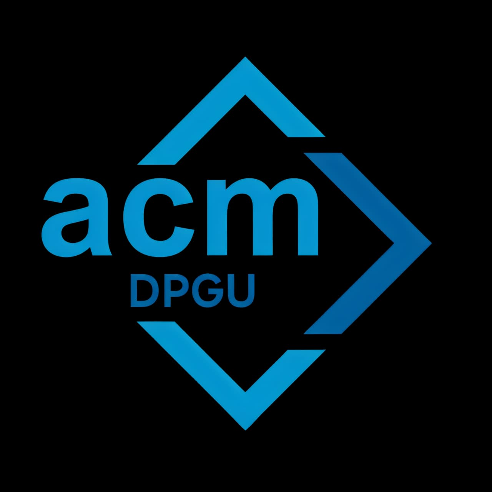
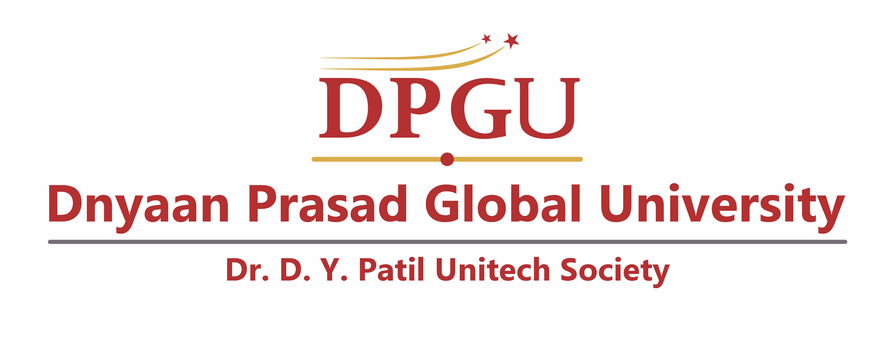
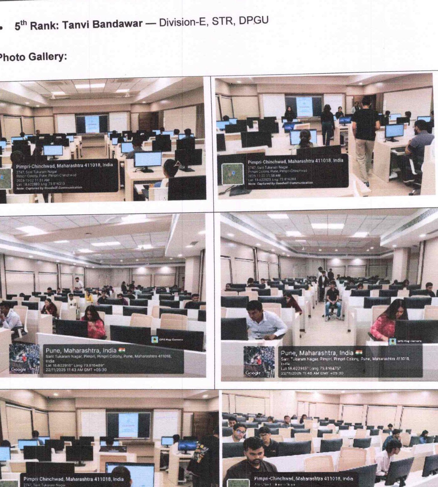
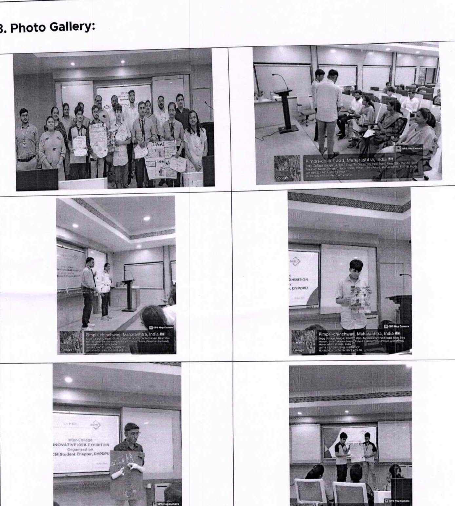
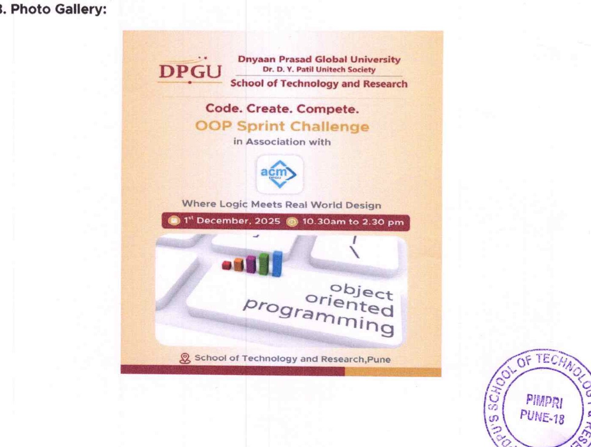

<div align="center">


&nbsp;&nbsp;&nbsp;&nbsp;&nbsp;&nbsp;&nbsp;&nbsp;


# DPGU ACM Student Chapter
### School of Technology and Research (STR)
**Dnyaan Prasad Global University (DPGU) — Pimpri, Pune, India**  
*(Under the Aegis of Dr. D. Y. Patil Unitech Society)*

[](#about-the-chapter)
[](#about-the-chapter)
[](#events-and-activities-archive)
[](ACM_DOCUMENTATION_AUDIT.md)

**Empowering student technologists through rigorous computing, collaborative systems engineering, and real-world impact.**

</div>

---

## Table of Contents
- [1. About the Chapter](#1-about-the-chapter)
- [2. What We Do](#2-what-we-do)
- [3. Chapter Highlights & Impact](#3-chapter-highlights--impact)
- [4. Events & Activities Archive](#4-events--activities-archive)
- [5. Featured Events](#5-featured-events)
- [6. Projects & Technical Work](#6-projects--technical-work)
- [7. Workshops & Knowledge Sharing](#7-workshops--knowledge-sharing)
- [8. Achievements & Recognition](#8-achievements--recognition)
- [9. Community & Collaboration](#9-community--collaboration)
- [10. Event Gallery](#10-event-gallery)
- [11. Technology Stack & Domains](#11-technology-stack--domains)
- [12. Join & Participate](#12-join--participate)
- [13. Resources & Documentation](#13-resources--documentation)
- [14. Institutional Acknowledgements](#14-institutional-acknowledgements)

---

## 1. About the Chapter

The **DPGU ACM Student Chapter** is the premier collegiate computing society of the **School of Technology and Research (STR)** at **Dnyaan Prasad Global University (DPGU)**, located in Pimpri, Pune. Established under the **Dr. D. Y. Patil Unitech Society**, the chapter operates under the worldwide academic charter of the **Association for Computing Machinery (ACM)** — the world's largest educational and scientific computing society.

The chapter was formally inaugurated on **Engineer's Day, 15th September 2025**, during the *Innovative Idea Exhibition*, creating a dedicated institutional platform to bridge the gap between classroom theory and real-world computational practice.

### Our Mission & Philosophy
- **Rigor in Computing**: Transitioning students from introductory programming syntax to algorithmic complexity analysis, clean system design, and competitive problem-solving.
- **Applied Innovation**: Facilitating student-led development of functional prototypes in Artificial Intelligence, High-Performance Computing, Agentic Systems, and Object-Oriented software architectures.
- **Industry & Academic Synergy**: Directly connecting students with global researchers, Silicon Valley principal scientists, and corporate technology executives from organizations including Fujitsu Research of America, Howard University, C-DAC, TCS, and Northern Trust.
- **Social & Civic Responsibility**: Leveraging computing education as an instrument of social empowerment through initiatives that teach digital literacy and web technologies to underprivileged students in municipal government schools.

---

## 2. What We Do

The chapter's activities span five interconnected domains:

```
+---------------------------------------------------------------------------------------------------+
|                                  DPGU ACM OPERATIONAL DOMAINS                                     |
+---------------------------------------------------------------------------------------------------+
|  [1] Competitive Programming     [2] Applied AI & Systems         [3] Research Masterclasses      |
|  - Multi-round C challenges      - Generative & Agentic AI        - ACM Distinguished Speakers    |
|  - HackerRank contest arenas     - C++ OOP system simulations     - High-Performance Computing    |
|  - OBSIDIAN Python series        - Fullstack web platforms        - 5G/6G wireless virtualization |
+---------------------------------------------------------------------------------------------------+
|  [4] State-Level Symposia        [5] Community Outreach           [6] Executive Dialogues         |
|  - 12-hour offline hackathons    - Municipal school mentoring     - CXO & Director panels         |
|  - Venture pitching arenas       - Digital literacy workshops     - AI ethics & cyber defense     |
+---------------------------------------------------------------------------------------------------+
```

1. **Competitive Programming & Hackathons**: Multi-tiered algorithmic contests including *Code Quest*, the *OBSIDIAN* Python competition series, and the flagship 12-hour *HELIX Hack Carnival*.
2. **Applied Artificial Intelligence & Systems**: Hands-on laboratories covering LLMs, autonomous intelligent agents, predictive machine learning pipelines, and modular object-oriented simulation software.
3. **Research Masterclasses & Distinguished Talks**: Authoritative technical lectures delivered by internationally recognized scholars through the ACM Distinguished Speaker Program and global corporate R&D divisions.
4. **Industrial Exposure & Field Studies**: On-site study visits to national research facilities such as the Centre for Development of Advanced Computing (C-DAC) to examine supercomputing clusters and petascale architectures.
5. **Community Outreach & Inclusivity**: Public technology literacy camps empowering pupils in local municipal schools with foundational web design and computing skills.

---

## 3. Chapter Highlights & Impact

All metrics below are verified through primary institutional records and signed post-event documentation (see [ACM Documentation Audit](ACM_DOCUMENTATION_AUDIT.md)):

<div align="center">

| Metric | Verification Scope | Official Document Reference |
| :---: | :--- | :--- |
| **14** | Distinct technical programs, hackathons, seminars, and outreach drives | `ACM_CLUB_DOCUMENTATION` (Reports 01–14) |
| **55+** | Official signed report pages, attendance ledgers, and feedback audits | Primary archival repository |
| **15+** | Senior enterprise directors, international researchers, and corporate judges engaged | Event reports & speaker registers |
| **12** | Enterprise and research partner organizations collaborating with the chapter | Corporate participant dossiers |
| **8** | Prominent engineering institutions participating in chapter symposia | `09_Helix.pdf`, `Activity Report...Exhibition.pdf` |
| **100%** | First-year CSE student cohort participation across 7 academic divisions in foundational coding | `Activity Report on Code Quest.pdf` |
| **4** | Flagship competitive tracks organized under the state-level HELIX symposium | `09_Helix.pdf` (Hack Carnival, Piranha Tank, etc.) |
| **1** | Dedicated civic digital training initiative conducted at a municipal public school | `03_Activity Report on ACM Community Connect.pdf` |

</div>

---

## 4. Events & Activities Archive

The chapter maintains an unbroken, verified chronological record of all technical initiatives from inception to the present date.

| Date | Event / Program Title | Category | Focus / Key Delivery | Verified Outcome / Milestone |
| :--- | :--- | :--- | :--- | :--- |
| **15 Sep 2025** | [Innovative Idea Exhibition](docs/events/2025.md#september-2025-innovative-idea-exhibition--acm-club-inauguration) | Competition & Charter | AI in Healthcare, Robotics & Automation | **Official Inauguration of the ACM Club** on Engineer's Day; 5 colleges |
| **20 & 22 Nov 2025** | [Code Quest 2025](docs/events/2025.md#november-2025-code-quest-2025) | Coding Contest | Foundational C programming & HackerRank | 100% FY CSE participation (7 divisions); 40 finalists; top 5 ranked |
| **01 Dec 2025** | [OOP Sprint Challenge](docs/events/2025.md#december-2025-oop-sprint-challenge) | Systems Sprint | C++ modular object-oriented simulation | 3-member teams; 6 enterprise problem statements modeled |
| **02 & 30 Jan 2026** | [Industrial Visit to C-DAC Pune](docs/events/2026.md#january-2026-industrial-visit-to-c-dac-pune) | Industrial Visit | Supercomputing & National Supercomputing Mission | 2 batches examined PARAM infrastructure and parallel computing |
| **Jan – Mar 2026** | [OBSIDIAN Contest Series](docs/events/2026.md#january--march-2026-obsidian-competitive-programming-series) | Contest Series | Python algorithmic problem solving on HackerRank | 3 competitive editions (24 Jan, 23 Feb, 14 Mar); 20+ problem bank |
| **31 Jan 2026** | [Industry Impact Dialogues](docs/events/2026.md#january-2026-industry-impact-dialogues--llms--chatgpt-in-academics) | Guest Lecture | LLMs, ChatGPT, and Academic Integrity | Keynote by Mr. Sujit Patange, Vice President, **Northern Trust** |
| **10 Feb 2026** | [Hands-On AI Agents Workshop](docs/events/2026.md#february-2026-hands-on-workshop--building-ai-applications--agents) | Masterclass | Agentic AI architectures & live prototyping | Session by Dr. Mehdi Bahrami, **Fujitsu Research of America** |
| **14 Feb 2026** | [Demystifying Data Science](docs/events/2026.md#february-2026-distinguished-speaker-program--demystifying-data-science) | Distinguished Talk | End-to-end data analytics & career roadmaps | Keynote by Dr. Neha Sharma, **TCS** / Founder Secretary SDS |
| **20 Feb 2026** | [ACM Distinguished Speaker Lecture](docs/events/2026.md#february-2026-acm-distinguished-speaker-lecture--wireless-virtualization) | Distinguished Lecture | 5G/6G Wireless Virtualization & Network Security | Lecture by Prof. Dr. Danda B. Rawat, **Howard University, Washington DC** |
| **27 Feb 2026** | [ACM Community Connect](docs/events/2026.md#february-2026-acm-community-connect--digital-training-for-school-students) | Social Outreach | Digital literacy & web building for school pupils | Outreach conducted at **PCMC Public School, Pimprigaon, Pune** |
| **10 Mar 2026** | [Women in Leadership Panel](docs/events/2026.md#march-2026-panel-discussion-on-women-in-leadership) | Panel Discussion | Gender equity & technical leadership trajectories | Commemorated in alignment with International Women's Day |
| **17 Apr 2026** | [HELIX 2026 Technical Fest](docs/events/2026.md#april-2026-helix-2026--flagship-state-level-technical-fest) | State Symposium | 12-hour Hackathon, Pitching, Quiz, Escape Room | Flagship state fest; 4 competitive tracks; 8 champion teams |
| **15 Sep 2026** | [TECH TREASURE](docs/events/2026.md#september-2026-tech-treasure--technical-quiz--hackerrank-arena) | Algorithmic Arena | Fast-paced technical quiz & HackerRank challenges | Conducted on Engineer's Day 2026; capped at first 50 registrants |
| **26 Oct 2026** | [Future in AI & Cybersecurity](docs/events/2026.md#october-2026-panel-discussion-on-future-in-ai-and-cybersecurity) | Executive Panel | Enterprise AI adoption & modern cyber defense | Executive panel: ClearRoute, TCS, ShellStrong, Vikasietum |

> For comprehensive event summaries, speaker bios, evaluation rubrics, and detailed results, consult the dedicated yearly archives:  
> 🔗 **[2025 Chapter Events Archive](docs/events/2025.md)** | 🔗 **[2026 Chapter Events Archive](docs/events/2026.md)**

---

## 5. Featured Events

### A. HELIX 2026 — Flagship State Level Technical Fest
*17th April 2026 | School of Technology and Research, DPGU*


*Figure 1: Student teams and evaluation panels during the 12-hour HELIX State Technical Fest.*

HELIX 2026 was organized as the chapter's flagship multi-track annual symposium, bringing together student innovators, competitive programmers, and aspiring startup founders from across the state for 12 hours of intensive engineering and technical defense.

- **Hack Carnival (12-Hour Offline Hackathon)**: Teams built functional software prototypes addressing complex challenges in AI, ML, and Cybersecurity.
  - *Industry Jury*: Mr. Tousiph Pirjade (TCS), Mr. Sanjay Pawase (Atos Syntel), Mr. Kedar Pokharkar (Exponentia.ai).
  - *Podium*: **1st Place**: Team *Onigiri* (Vishwakarma Institute of Technology - VIT Pune) | **Runners-Up**: Team *Merge Conflicts* (Dr. D. Y. Patil Institute of Technology - DIT Pune).
- **Piranha Tank (Venture Pitching Arena)**: Modeled after startup pitch rooms, student innovators defended business scalability, technical viability, and unit economics.
  - *Industry Jury*: Mr. Sujeet Patange (Northern Trust), Mr. Mohit Chordiya (Allianz Technology).
  - *Podium*: **1st Place**: Team *Qryptic Labs* (Indira College of Engineering & Management) | **Runners-Up**: Team *SPD* (STR, DPGU).
- **Buzzer Quiz & Escape Room**: Multi-round technical trivia won by Team *Fast and Curious* (STR, DPGU), and a gamified cryptographic challenge won by *Aditya Shinde* (STR, DPGU).

---

### B. ACM Distinguished Speaker Program — Wireless Virtualization & Next-Gen Networking
*20th February 2026 | Global Live Stream: Howard University (Washington, DC) to DPGU STR*


*Figure 2: ACM Distinguished Speaker session delivered by Prof. Dr. Danda B. Rawat.*

Delivered by **Professor (Dr.) Danda B. Rawat** — Professor of Electrical Engineering & Computer Science at **Howard University, Washington, DC**, and Director of the Howard University Data Science and Cybersecurity Center (DSC2).

- **Technical Depth**: Advanced architectural exploration of Wireless Network Virtualization (WNV) in 5G and anticipated 6G networks, utilizing AI/ML models for dynamic resource slicing and spectral optimization.
- **Cyber Defense Mechanisms**: Evaluated proactive wireless security models including deceptive networks, Mobile Virtual Network Operators (MVNOs), and honeypots.
- **Verified Impact**: Streamed to Second Year B.Tech Computer Network and Security students. Post-session Google Forms analytics confirmed a **93.8% comprehension rating** and **86.7% enthusiasm** for continued international research sessions.

---

### C. Hands-On Masterclass — Building Advanced AI Applications & Agents in One Hour
*10th February 2026 | Virtual Masterclass: Fujitsu Research of America (California) to DPGU STR*


*Figure 3: Interactive demonstration on agentic architectures by Dr. Mehdi Bahrami.*

Conducted by **Dr. Mehdi Bahrami**, Principal Researcher at **Fujitsu Research of America** (Sunnyvale, California, USA).

- **Paradigm Shift**: Guided students beyond static prompt generation to autonomous agent loops equipped with memory stores, tool-calling interfaces, and multi-step reasoning chains.
- **Rapid Prototyping**: In a 60-minute hands-on sprint, attendees scaffolded an intelligent agent application capable of dynamic external API integration and autonomous task resolution.

---

### D. Industrial Field Visit to C-DAC Pune (National Supercomputing Mission)
*02 & 30 January 2026 | C-DAC Research Campus, Pashan, Pune*


*Figure 4: Students and faculty outside the Centre for Development of Advanced Computing (C-DAC).*

Undergraduate engineering students completed two cohort visits to the **Centre for Development of Advanced Computing (C-DAC)** under the Ministry of Electronics & IT, Government of India.

- **Supercomputing Infrastructure**: Inspected high-density server racks, liquid-cooled compute nodes, and petascale storage fabrics powering India's **PARAM series** supercomputers.
- **Research Dialogues**: Interacted with national research scientists regarding parallel programming standards (MPI, OpenMP), GPU acceleration, and national initiatives in indigenous processor development.

---

### E. ACM Community Connect — Digital Training for Municipal School Students
*27th February 2026 | PCMC Public School, Pimprigaon, Pune*


*Figure 5: Chapter student volunteers mentoring young pupils during the digital training camp.*

Reflecting ACM's core commitment to social responsibility and technical equity, student volunteers traveled to **PCMC Public School in Pimprigaon, Pune** (a municipal public school).

- **Bridging the Digital Divide**: Delivered structured digital literacy, computer hardware fundamentals, and website design concepts to pupils who lacked formal computing laboratories.
- **Hands-On Learning**: Mentored students through visual layout builders and beginner-friendly Content Management Systems, inspiring young minds toward STEM and software engineering.

---

## 6. Projects & Technical Work

The chapter fosters a culture of building functional software. Documented projects are categorized below according to their verified development status:

```
+---------------------------------------------------------------------------------------------------+
|                                  PROJECT CLASSIFICATION LEDGER                                    |
+---------------------------------------------------------------------------------------------------+
|  [DEPLOYED PLATFORM]     Official Chapter Web Platform (Next.js 16 + Supabase + Crypto Auth)       |
|  [SYSTEM PROTOTYPES]     C++ OOP Simulations (Food Delivery, Energy Balancer, Ride Sharing)       |
|  [CONTEST REPOSITORIES]  OBSIDIAN Algorithmic Bank (20+ Verified Python Problem Statements)       |
+---------------------------------------------------------------------------------------------------+
```

### 1. Official Chapter Web Platform (`dpgu-acm-official-portal`)
- **Status**: **Completed & Active** (Core digital infrastructure)
- **Architecture**: Next.js 16 (App Router), React 19, TypeScript 5, Tailwind CSS 4, Supabase (PostgreSQL), Zod.
- **Key Modules**:
  - *Accountless Guest Registration Engine*: Students register individually or as squads for free/paid events without password fatigue, with strict schema validation.
  - *Dynamic Team Bounds*: Enforces configurable team sizing constraints (`min_team_size` and `max_team_size`) with automated duplicate email detection.
  - *Atomic Seating Guard*: Eliminates overselling via server-side atomic capacity checks.
  - *Cryptographic Boarding Passes*: Generates unpredictable 128-bit entropy references (`ref_<hex>`) and sanitized print-ready passes.
  - *Administrative Control Center*: Edge-middleware protected dashboard featuring PBKDF2 cryptography, attendance check-in gate scanning, and CSV export telemetry.
- **Source**: `DPGU_ACM_WEBSITE` repository; requested on behalf of the HELIX Organizing Team (`Application Website.docx`).

### 2. OOP Sprint C++ System Simulation Models
- **Status**: **Completed Technical Prototypes**
- **Architecture**: C++ console applications utilizing OOP principles (inheritance, encapsulation, polymorphism, data abstraction).
- **Documented Implementations**:
  - **Smart Campus Energy Balancer**: Multi-building load-shedding simulation prioritizing critical educational laboratory equipment during electrical peak demand.
  - **Food Delivery Platform Simulation**: Multi-tier architecture modeling real-time state machines for customers, restaurant kitchens, and courier dispatch.
  - **Ride Sharing System**: Geospatial driver-passenger matching algorithm featuring dynamic surge tariff calculations.
  - **Grocery Store Billing Engine**: Inventory SKU ledger with automated VAT/GST calculations and receipt generation.
  - **Tea Stall & Car Wash Management Systems**: Point-of-sale inventory tracking and service bay queue scheduling engines.
- **Source**: `Activity Report on OOP Sprint Challenge.pdf`.

### 3. OBSIDIAN Algorithmic Problem Repository
- **Status**: **Verified Contest Repository**
- **Technology**: Python 3; HackerRank test harness.
- **Overview**: 20+ documented competitive problems assessing numerical parity, recursive sequences, string tokenizers, palindrome validation, combinatorial counting, and time complexity bounds.
- **Source**: `obsidian_october.docx` problem bank.

---

## 7. Workshops & Knowledge Sharing

The chapter prioritizes technical knowledge exchange through structured guest lectures and interactive workshops:

<div align="center">

| Technical Program | Resource Person & Affiliation | Core Focus & Topics |
| :--- | :--- | :--- |
| **Building AI Applications & Agents** | **Dr. Mehdi Bahrami**<br>Principal Researcher, *Fujitsu Research of America* | Agentic AI loops, autonomous decision agents, tool-calling APIs, and live agent prototyping |
| **Demystifying Data Science** | **Dr. Neha Sharma**<br>Professional, *TCS* / Founder Sec., *Society for Data Science* | Data analytics lifecycle, predictive modeling, machine learning in healthcare/finance, career roadmaps |
| **Wireless Virtualization in 5G/6G** | **Prof. (Dr.) Danda B. Rawat**<br>Professor & Center Director, *Howard University (USA)* | 5G/6G network slicing, AI-driven radio resource management, wireless honeypots, and digital twins |
| **Effective Use of LLMs in Academics** | **Mr. Sujit Patange**<br>Vice President, *Northern Trust* | Responsible enterprise deployment of LLMs, prompt engineering, and maintaining academic integrity |
| **Future in AI & Cybersecurity Panel** | **Ms. Supriya Rao** (*ClearRoute*)<br>**Mr. Vikash Shukla** (*TCS*)<br>**Mr. Shashank Borude** (*ShellStrong*)<br>**Mr. Nilesh Miskin** (*Vikasietum*) | Enterprise AI transformation, cloud threat surface mitigation, automated threat intelligence, and graduate hiring expectations |
| **Women in Leadership Panel** | Distinguished Women Industry Professionals | Promoting gender equity in computing, dismantling workplace bias, and fostering technical leadership |

</div>

---

## 8. Achievements & Recognition

The chapter celebrates verified competition victories and podium finishes achieved during chapter-organized state and collegiate competitions:

```
+----------------------------------------------------------------------------------------------------+
|                                    VERIFIED CHAPTER HONORS ROSTER                                  |
+----------------------------------------------------------------------------------------------------+
|  HELIX 2026 HACK CARNIVAL    Team Onigiri (VIT Pune)                   1st Place (Champions)       |
|  HELIX 2026 HACK CARNIVAL    Team Merge Conflicts (DIT Pune)           2nd Place (Runners-Up)      |
|  HELIX 2026 PIRANHA TANK     Team Qryptic Labs (ICEM Pune)             1st Place (Winners)         |
|  HELIX 2026 PIRANHA TANK     Team SPD (STR, DPGU)                      2nd Place (Runners-Up)      |
|  HELIX 2026 BUZZER QUIZ      Team Fast and Curious (STR, DPGU)         1st Place (Winners)         |
|  HELIX 2026 BUZZER QUIZ      Team HSR Team (STR, DPGU)                 2nd Place (Runners-Up)      |
|  HELIX 2026 ESCAPE ROOM      Aditya Shinde (STR, DPGU)                 1st Place (Winner)          |
|  AI POSTER EXHIBITION 2025   Lazina S. Shaikh (JSPM RSCOE)             1st Prize                   |
|  AI POSTER EXHIBITION 2025   Jayvardhan S. Gaikwad (PCCOE)             2nd Prize                   |
|  AI POSTER EXHIBITION 2025   Raghav Gurung (STR, DPGU)                 3rd Prize                   |
|  CODE QUEST 2025             Devansh Deshmukh (Div B, STR, DPGU)       1st Rank (Top of Cohort)    |
|  CODE QUEST 2025             Mustafa (Div F, STR, DPGU)                2nd Rank                    |
|  CODE QUEST 2025             Yash Bhanushali (Div G, STR, DPGU)        3rd Rank                    |
+----------------------------------------------------------------------------------------------------+
```

---

## 9. Community & Collaboration

The chapter maintains active collaborations across three key pillars:

### A. Academic & Collegiate Consortium
The chapter regularly hosts inter-collegiate competitions and knowledge symposiums, drawing active teams and researchers from prominent institutions:
- **Vishwakarma Institute of Technology (VIT), Pune**
- **Dr. D. Y. Patil Institute of Technology (DIT), Pimpri, Pune**
- **Pimpri Chinchwad College of Engineering (PCCOE), Akurdi, Pune**
- **Indira College of Engineering and Management (ICEM), Pune**
- **JSPM's Rajarshi Shahu College of Engineering (RSCOE), Tathawade, Pune**
- **MIT Academy of Engineering (MIT AOE), Alandi, Pune**
- **Marathwada Mitra Mandal College of Engineering (MMCOE), Pune**

### B. Corporate & Research Partners
Senior engineers, executives, and scientists from leading technology organizations actively mentor chapter members, formulate real-world problem statements, and evaluate student prototypes:
- **Fujitsu Research of America** (Sunnyvale, California, USA)
- **Howard University Data Science & Cybersecurity Center (DSC2)** (Washington, DC, USA)
- **Centre for Development of Advanced Computing (C-DAC)** (MeitY, Government of India)
- **Northern Trust**
- **Tata Consultancy Services (TCS)**
- **ClearRoute**
- **Vikasietum**
- **ShellStrong**
- **Atos Syntel**
- **Exponentia.ai**
- **Allianz Technology**
- **HCLTech**
- **LTIMindtree**

### C. Civic & Social Outreach
Through the **ACM Community Connect** initiative, the chapter maintains active educational partnerships with municipal government schools (such as **PCMC Public School, Pimprigaon, Pune**), deploying university student volunteers to deliver digital literacy and web development training to young pupils.

---

## 10. Event Gallery

*All photographs below are extracted directly from official chapter activity reports with verified geospatial and institutional metadata.*

<div align="center">

| | |
|:---:|:---:|
| <br><sub>**HELIX 2026 State Technical Fest**<br>Hack Carnival & Piranha Tank participants</sub> | <br><sub>**C-DAC Pune Industrial Visit**<br>Students at National Supercomputing facility</sub> |
| <br><sub>**Hands-On AI Agents Workshop**<br>Virtual masterclass with Dr. Mehdi Bahrami (Fujitsu)</sub> | <br><sub>**ACM Distinguished Speaker Lecture**<br>Prof. Dr. Danda B. Rawat (Howard University)</sub> |
| <br><sub>**Distinguished Speaker Program**<br>Dr. Neha Sharma (TCS / Society for Data Science)</sub> | <br><sub>**ACM Community Connect**<br>Volunteers mentoring students at PCMC Public School</sub> |
| <br><sub>**Code Quest 2025**<br>First-year students in live HackerRank coding arena</sub> | <br><sub>**Innovative Idea Exhibition & Inauguration**<br>Inter-college AI research poster presentations</sub> |
| <br><sub>**OOP Sprint Challenge**<br>Teams modeling C++ console system architectures</sub> | <br><sub>**OBSIDIAN Contest Series**<br>First-year engineering students solving Python problems</sub> |

</div>

---

## 11. Technology Stack & Domains

The chapter actively engages in, conducts workshops around, and develops software using modern industry-standard languages, platforms, and frameworks:

### Core Programming Languages
- **C**: Systems programming, memory management, and competitive algorithmic challenges (*Code Quest 2025*).
- **C++**: Object-oriented system modeling, class hierarchies, and simulation engines (*OOP Sprint Challenge*).
- **Python**: Competitive coding on HackerRank (*OBSIDIAN series*), data science pipelines, and AI agent frameworks.
- **TypeScript & JavaScript**: Enterprise fullstack web applications, type-safe API routing, and event platform infrastructure.
- **SQL (PostgreSQL)**: Relational schema migrations, indexing, and transactional integrity (*Supabase persistence*).

### Frameworks, Libraries & Platforms
- **Web & Cloud**: Next.js 16 (App Router), React 19, Tailwind CSS 4, Node.js, Supabase, Zod, Edge Middleware.
- **Competitive Platforms**: HackerRank, wayground.com.
- **High-Performance & Scientific Computing**: C-DAC PARAM supercomputing clusters, Linux server environments, parallel processing frameworks.
- **AI & Systems Disciplines**: Agentic AI loops, Generative AI models, Large Language Models (LLMs), Wireless Network Virtualization (WNV), 5G/6G network slicing, and Honeypot security deception.

---

## 12. Join & Participate

Participation in the DPGU ACM Student Chapter is open to all enrolled undergraduate and postgraduate students of Dnyaan Prasad Global University across all engineering and technical disciplines.

### Ways to Get Involved
1. **Participate in Coding Competitions & Hackathons**: Compete in chapter-hosted competitive rounds including the *OBSIDIAN* series, *Code Quest*, and the annual *HELIX* Hackathon.
2. **Attend Technical Masterclasses & Guest Lectures**: Join hands-on workshops on Agentic AI, Data Science, and Systems Engineering conducted by international researchers and industry leaders.
3. **Contribute to Open-Source Projects**: Collaborate with the chapter's Webmaster Directorate on the official web platform and system simulation repositories.
4. **Volunteer for Community Outreach**: Join the *ACM Community Connect* team to teach foundational computing and digital literacy to young pupils in local municipal schools.

### Official Contact & Inquiries
- **Physical Desk**: DPGU ACM Student Chapter Office, School of Technology and Research (STR Building), Dnyaan Prasad Global University Campus, Sant Tukaram Nagar, Pimpri Colony, Pune, Maharashtra 411018.
- **Faculty Leadership**: Contact **Prof. Shabana T Pirjade**, ACM Faculty Coordinator, STR Building.

---

## 13. Resources & Documentation

- 📋 **[ACM Documentation Audit & Evidence Ledger](ACM_DOCUMENTATION_AUDIT.md)**: Verified source of truth detailing every document, metric, and discrepancy across 14 official historical reports.
- 📅 **[2025 Chapter Events Archive](docs/events/2025.md)**: Detailed report on the chapter inauguration, Code Quest 2025, and OOP Sprint Challenge.
- 📅 **[2026 Chapter Events Archive](docs/events/2026.md)**: Detailed coverage of the C-DAC visit, OBSIDIAN series, AI Agent workshop, ACM Distinguished Speaker lecture, HELIX 2026, and executive panels.

---

## 14. Institutional Acknowledgements

The DPGU ACM Student Chapter expresses its sincere gratitude to the university leadership, faculty mentors, industry partners, and student leaders whose dedication drives our community forward:

### Institutional & Faculty Leadership
- **Prof. Shabana T Pirjade** — ACM Faculty Coordinator, School of Technology and Research
- **Dr. Mithra Venkatesan** — Director (I/C) / Dean, School of Technology and Research
- **Dr. Vinod M. Kimbahune** — Director Incharge, School of Technology and Research
- **Dr. D. G. Bhalke** — Director (I/C), School of Technology and Research
- **Dr. Kailash N. Tripathi** — Faculty Coordinator (Computer Network and Security)
- **Prof. Rucha Madali** — Faculty Coordinator (Object-Oriented Programming)

### Distinguished Speakers & Industry Mentors
- **Dr. Mehdi Bahrami** — Principal Researcher, *Fujitsu Research of America* (California, USA)
- **Professor (Dr.) Danda B. Rawat** — ACM Distinguished Speaker & Center Director, *Howard University* (Washington, DC, USA)
- **Dr. Neha Sharma** — TCS Professional, Senior IEEE Member, Founder Secretary — *Society for Data Science*
- **Mr. Sujit Patange** — Vice President, *Northern Trust*
- **Ms. Supriya Rao** — Regional Managing Director, *ClearRoute*
- **Mr. Vikash Shukla** — Associate Consultant, *Tata Consultancy Services (TCS)*
- **Mr. Shashank Borude** — Strategic Partner, *ShellStrong*
- **Mr. Nilesh Miskin** — Chief Digital Officer, *Vikasietum*
- **Mr. Tousiph Pirjade** — *Tata Consultancy Services (TCS)*
- **Mr. Sanjay Pawase** — Technical Consultant, *Atos Syntel*
- **Mr. Kedar Pokharkar** — *Exponentia.ai*
- **Mr. Mohit Chordiya** — *Allianz Technology*
- **Mr. Yash Patel** — Technical Lead, *HCLTech*
- **Ms. Preeti Chadchankar** — Senior Quality Analyst, *LTIMindtree*
- **Scientific Officers & Research Staff** — *Centre for Development of Advanced Computing (C-DAC), Pune*

---

<div align="center">

**DPGU ACM Student Chapter**  
*School of Technology and Research, Dnyaan Prasad Global University*  
Sant Tukaram Nagar, Pimpri, Pune, Maharashtra 411018, India  
Charter Affiliation: [Association for Computing Machinery (ACM)](https://www.acm.org)

<sub>© DPGU ACM Student Chapter. All rights reserved. Documented under the official historical records of the chapter.</sub>

</div>
