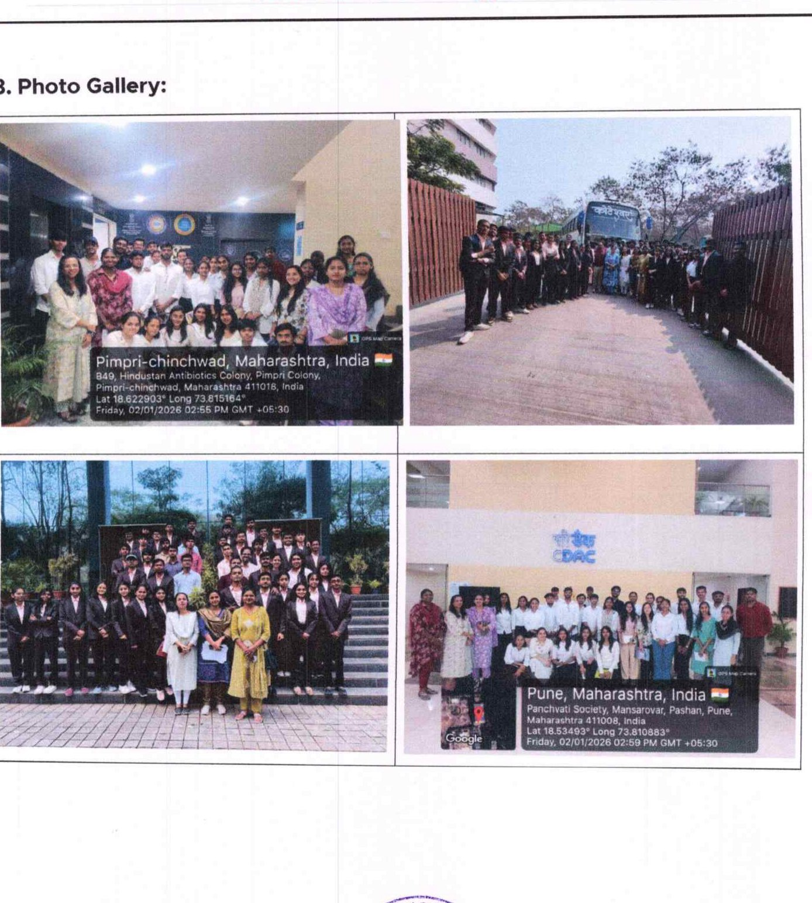
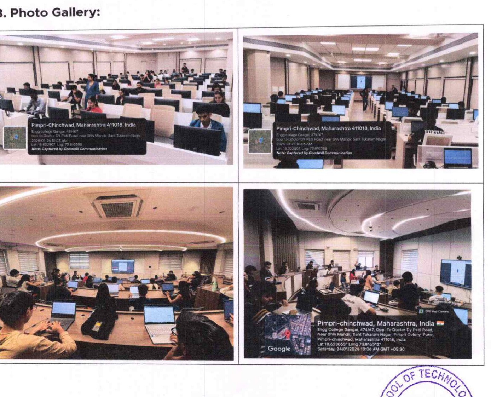
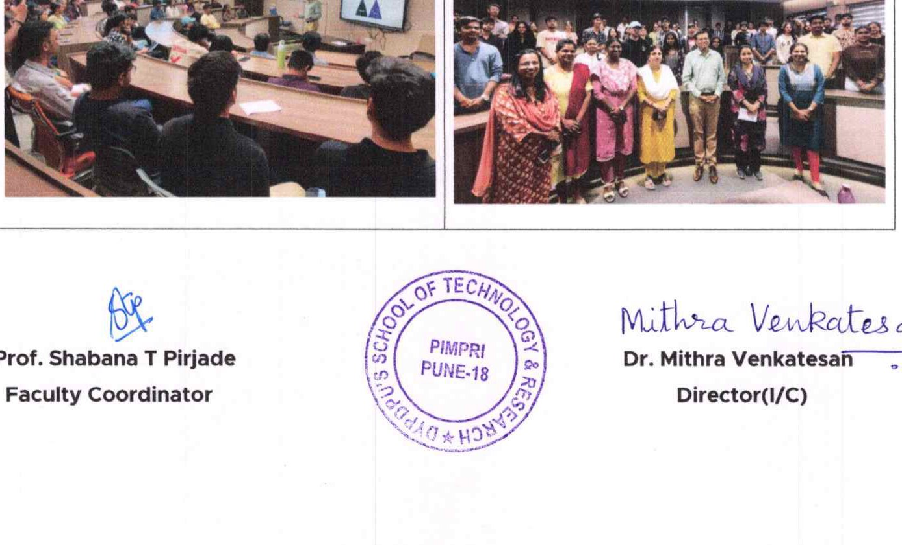
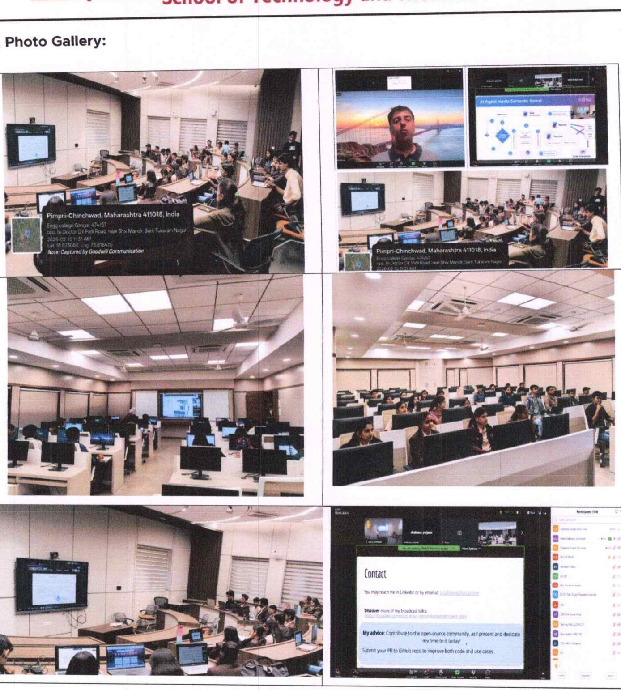
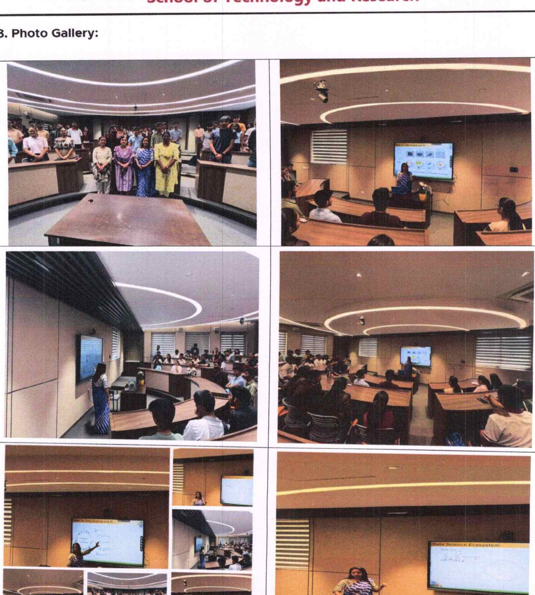
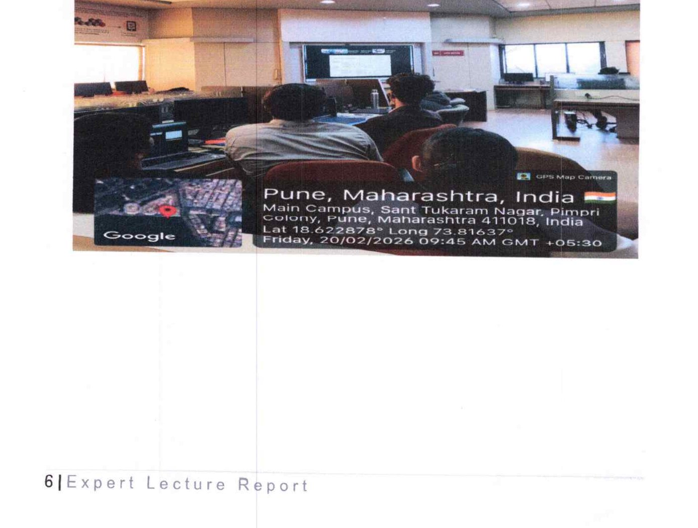
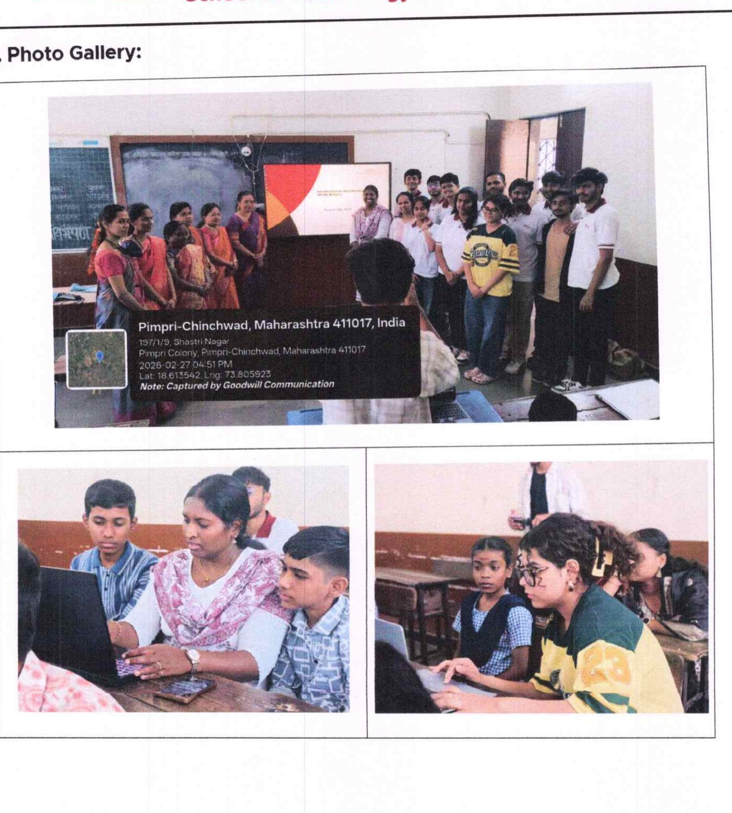
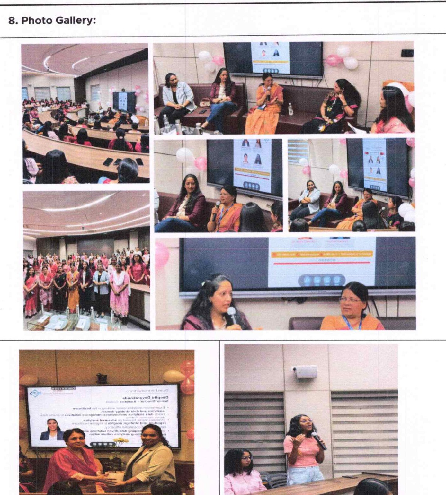
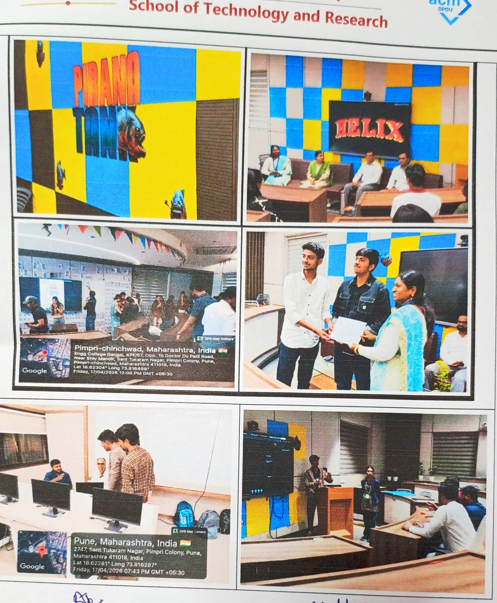

# DPGU ACM Student Chapter — 2026 Events Archive

This archive contains detailed historical documentation of all official events, technical masterclasses, competitive hackathons, industrial visits, community outreach initiatives, and executive panels conducted by the **DPGU ACM Student Chapter** (School of Technology and Research, Dnyaan Prasad Global University, Pimpri, Pune) during the 2026 calendar year.

---

## Table of Contents
1. [January 2026: Industrial Visit to C-DAC Pune](#january-2026-industrial-visit-to-c-dac-pune)
2. [January – March 2026: OBSIDIAN Competitive Programming Series](#january--march-2026-obsidian-competitive-programming-series)
3. [January 2026: Industry Impact Dialogues — LLMs & ChatGPT in Academics](#january-2026-industry-impact-dialogues--llms--chatgpt-in-academics)
4. [February 2026: Hands-On Workshop — Building AI Applications & Agents](#february-2026-hands-on-workshop--building-ai-applications--agents)
5. [February 2026: Distinguished Speaker Program — Demystifying Data Science](#february-2026-distinguished-speaker-program--demystifying-data-science)
6. [February 2026: ACM Distinguished Speaker Lecture — Wireless Virtualization](#february-2026-acm-distinguished-speaker-lecture--wireless-virtualization)
7. [February 2026: ACM Community Connect — Digital Training for School Students](#february-2026-acm-community-connect--digital-training-for-school-students)
8. [March 2026: Panel Discussion on Women in Leadership](#march-2026-panel-discussion-on-women-in-leadership)
9. [April 2026: HELIX 2026 — Flagship State Level Technical Fest](#april-2026-helix-2026--flagship-state-level-technical-fest)
10. [September 2026: TECH TREASURE — Technical Quiz & HackerRank Arena](#september-2026-tech-treasure--technical-quiz--hackerrank-arena)
11. [October 2026: Panel Discussion on Future in AI and Cybersecurity](#october-2026-panel-discussion-on-future-in-ai-and-cybersecurity)

---

## January 2026: Industrial Visit to C-DAC Pune


*Figure 1: DPGU engineering students and faculty at the C-DAC Pune National Supercomputing Facility.*

### Overview
- **Official Title**: Industrial Visit to Centre for Development of Advanced Computing (C-DAC), Pune
- **Dates Conducted**:
  - **Batch 1**: 2nd January 2026 (Friday)
  - **Batch 2**: 30th January 2026 (Friday)
- **Venue**: C-DAC Innovation & Research Campus (Pashan / Panchvati, Pune, Maharashtra — Under Ministry of Electronics & IT, Government of India)
- **Organized By**: ACM Student Chapter, School of Technology & Research, DPGU

### Objectives & Technical Scope
- Expose undergraduate students directly to India's premier national R&D organization driving the **National Supercomputing Mission (NSM)**.
- Demystify large-scale High-Performance Computing (HPC) clusters, parallel architectures, and supercomputing infrastructure (PARAM series).
- Provide foundational insights into C-DAC's applied research in Artificial Intelligence, High-Performance Storage, Cyber Security Frameworks, and National e-Governance Infrastructure.
- Connect theoretical algorithms taught in computer architecture and operating systems with petascale hardware execution.

### Key Activities & Takeaways
- Guided technical walk-through of active server farms, liquid cooling loops, and high-throughput networking backbones.
- Interactive briefing sessions conducted by senior C-DAC scientific officers detailing career pathways in scientific computing, parallel programming (MPI/OpenMP), and high-reliability systems.
- Q&A exploring national HPC internship opportunities, open research repositories, and indigenous computing initiatives.

### Institutional Leadership
- **ACM Faculty Coordinator**: Prof. Shabana T Pirjade
- **Director (I/C)**: Dr. Mithra Venkatesan
- **Primary Source**: `07_Report on Industrial Visit To C-DAC.pdf` (Pages 1–3)

---

## January – March 2026: OBSIDIAN Competitive Programming Series


*Figure 2: First-year engineers solving algorithmic problem statements during an OBSIDIAN round.*

### Overview
- **Official Title**: OBSIDIAN — Think Sharp, Code Sharper
- **Dates & Editions**:
  - **Round 1**: 24th January 2026 (Saturday)
  - **Round 2**: 23rd February 2026 (Monday)
  - **Round 3**: 14th March 2026 (Saturday)
- **Venue**: School of Technology & Research, DPGU (Conducted online via HackerRank)
- **Organized By**: ACM Student Chapter, School of Technology & Research, DPGU

### Objectives & Format
- **Mandatory Cohort**: Entire First Year STR student body.
- **Language Mandate**: **Python** was established as the compulsory language to test core logic without syntactic boilerplate.
- **Platform**: Online contest deployment on HackerRank featuring instant test-case verification and dynamic live leaderboard tracking.
- **Algorithmic Spectrum**: 20+ documented competitive problems spanning string transformations, numerical parity checks, recursive sequences, array counters, palindromes, and combinatorial optimization.

### Impact & Learning Outcomes
- Established an institutional benchmark for first-year coding proficiency.
- Transitioned students from basic script writing to edge-case analysis, computational complexity management, and competitive contest psychology.
- Served as the primary scouting mechanism for collegiate competitive programming delegations.

### Institutional Leadership
- **ACM Faculty Coordinator**: Prof. Shabana T Pirjade
- **Director (I/C)**: Dr. Mithra Venkatesan
- **Primary Source**: `05_Activity Report on OBSIDIAN.pdf` (Pages 1–3); problem set verified in `obsidian_october.docx`.

---

## January 2026: Industry Impact Dialogues — LLMs & ChatGPT in Academics


*Figure 3: Keynote seminar on responsible enterprise and academic integration of LLMs.*

### Overview
- **Official Title**: Industry Impact Dialogues: Effective Use of LLMs — ChatGPT in Academics
- **Date**: 31st January 2026 (Saturday)
- **Venue**: Room 001, School of Technology & Research Building, DPGU, Pune
- **Organized By**: ACM Student Chapter, School of Technology & Research, DPGU
- **Keynote Speaker**: **Mr. Sujit Patange** — Vice President, **Northern Trust**

### Core Themes & Key Takeaways
- **Demystifying Modern LLMs**: Architectural mechanics of generative transformers, tokenization limits, and context windows.
- **Academic Augmentation**: Utilizing LLMs as interactive Socratic tutors, automated code documenters, and literature synthesis assistants.
- **Ethics & Integrity**: Critical analysis of generative hallucinations, copyright considerations, model bias, and preventing academic plagiarism.
- **Enterprise Alignment**: Transition from hobbyist prompting to structured prompt engineering, retrieval-augmented pipelines, and API integrations in corporate financial environments.

### Institutional Leadership
- **ACM Faculty Coordinator**: Prof. Shabana T Pirjade
- **Director (I/C)**: Dr. Mithra Venkatesan
- **Primary Source**: `04_Activity Report on Industry Impact Dialogues.pdf` (Pages 1–2)

---

## February 2026: Hands-On Workshop — Building AI Applications & Agents


*Figure 4: Students engaged in the virtual hands-on AI Agent masterclass.*

### Overview
- **Official Title**: A Hands-On Workshop: Building Advanced AI Applications and Agents in One Hour
- **Date**: 10th February 2026 (Tuesday)
- **Venue & Mode**: Online via Zoom (streamed directly to STR computer laboratories)
- **Organized By**: Computational Thinking and Programming Team in Association with ACM Student Chapter, STR, DPGU
- **Expert Speaker**: **Dr. Mehdi Bahrami** — Principal Researcher, **Fujitsu Research of America** (Sunnyvale, California, USA)

### Technical Curriculum & Live Prototyping
- **The Agentic AI Shift**: Transitioning from passive text generation to autonomous intelligent agents equipped with memory, planning, and tool-calling primitives.
- **Core Agent Architecture**: Implementing perception-action loops, tool invocation interfaces, and state management.
- **60-Minute Rapid Build**: Live step-by-step walkthrough scaffolding a functional agent application capable of dynamic reasoning and automated task execution.
- **Industry Research Trends**: Emerging patterns in multi-agent orchestration, agentic reflection, and safety guardrails across enterprise systems.

### Institutional Leadership
- **ACM Faculty Coordinator**: Prof. Shabana T Pirjade
- **Director (I/C)**: Dr. Mithra Venkatesan
- **Primary Source**: `02_Activity Report on A Hands On Workshop.pdf` (Pages 1–3)

---

## February 2026: Distinguished Speaker Program — Demystifying Data Science


*Figure 5: Dr. Neha Sharma delivering the keynote address on Data Science competencies.*

### Overview
- **Official Title**: Distinguished Speaker Program on "Demystifying Data Science"
- **Date**: 14th February 2026 (Saturday)
- **Venue**: School of Technology & Research Building, DPGU, Pimpri, Pune
- **Organized By**: Computational Thinking and Programming Team in Association with ACM Student Chapter, STR, DPGU
- **Distinguished Speaker**: **Dr. Neha Sharma** — **TCS Professional**, Senior IEEE Member, Founder Secretary — **Society for Data Science**

### Thematic Focus & Guidance
- **Foundational Clarifications**: Separating data science reality from commercial hype; defining the intersection of statistics, domain expertise, and computing.
- **The End-to-End Analytics Lifecycle**: Data collection, exploratory cleaning, exploratory data analysis (EDA), predictive modeling, model interpretability, and production deployment.
- **Cross-Sector Deployments**: Comparative exploration of data workflows across healthcare telemetry, retail inventory forecasting, fraud detection in banking, and academic research.
- **Career Blueprint**: Navigating industrial certifications, practical open-source project development, technical portfolio structuring, and interview readiness.

### Institutional Leadership
- **ACM Faculty Coordinator**: Prof. Shabana T Pirjade
- **Director (I/C)**: Dr. Mithra Venkatesan
- **Primary Source**: `01_Activity Report of Distinguished Speaker Program on Demystifying Data Science.pdf` (Pages 1–3)

---

## February 2026: ACM Distinguished Speaker Lecture — Wireless Virtualization


*Figure 6: Global research lecture streamed live from Howard University, Washington, DC.*

### Overview
- **Official Title**: ACM Distinguished Speaker Program on "Wireless Virtualization for Enhancing Network Capacity, Network Coverage, Energy Efficiency, and Wireless Security for Next-Generation Wireless Networking"
- **Date & Timing**: 20th February 2026 (Friday), 09:30 AM – 11:00 AM IST
- **Venue & Mode**: Online (Zoom, streamed from Washington, DC) conducted for Second Year Computer Network and Security students at STR, DPGU
- **Organized By**: Department of Computer Science and Engineering - School of Technology and Research
- **ACM Distinguished Speaker**: **Professor (Dr.) Danda B. Rawat** — Professor of Electrical Engineering & Computer Science at **Howard University, Washington, DC, USA**; Director of Howard University Data Science and Cybersecurity Center (DSC2); ACM Distinguished Speaker

### Cutting-Edge Technical Curriculum
- **Wireless Network Virtualization (WNV)**: Slicing physical spectrum into multiple isolated virtual networks to maximize resource efficiency and spectral density.
- **AI/ML Optimization Loops**: Implementing adaptive machine learning models for real-time radio resource management, handoff anticipation, and predictive beamforming.
- **Next-Generation Telecom**: Architectural evolution from 5G Standalone to anticipated 6G terahertz communication and ultra-reliable low-latency networking (URLLC).
- **Proactive Wireless Cybersecurity**: Advanced deception techniques, Mobile Virtual Network Operators (MVNOs), and honeypots designed to detect and neutralize wireless intrusion vectors.
- **Smart City Infrastructure & Digital Twins**: Real-time wireless telemetry modeling entire physical municipal assets.

### Verified Audience Telemetry & Feedback Analytics
- **Verified Cohort**: Second Year B.Tech Computer Network and Security (Divisions A, B, etc.).
- **Feedback Analysis (16 Verified Submissions in Report Dossier)**:
  - **93.8%** of student attendees reported the complex concepts were clearly communicated and easy to understand.
  - **86.7%** voted affirmatively for continuous inclusion of international expert sessions.
  - **50.0%** rated syllabus relevance at a maximum 5/5 (with 43.8% scoring 4/5).
  - **56.3%** awarded the speaker's domain mastery 5/5.

### Institutional Leadership
- **Faculty Coordinator**: Dr. Kailash N. Tripathi
- **Director (I/C)**: Dr. Mithra Venkatesan
- **Primary Source**: `08_Expert Lectures_CNS.pdf` (Pages 1–17)

---

## February 2026: ACM Community Connect — Digital Training for School Students


*Figure 7: Chapter student volunteers conducting hands-on digital training at PCMC Public School Pimprigaon.*

### Overview
- **Official Title**: ACM Community Connect: Digital Training (Website Building)
- **Date & Timing**: 27th February 2026 (Friday), 3:30 PM
- **Venue**: **PCMC Public School, Pimprigaon, Pune** (Municipal Corporation Public School)
- **Organized By**: ACM Student Chapter, School of Technology & Research, DPGU

### Purpose & Community Impact
- **Bridging the Digital Divide**: Providing structured digital and web development training to underprivileged school students in government municipal schools who lack dedicated computer laboratory curricula.
- **Curriculum Delivered**:
  - Fundamentals of computing hardware, mouse navigation, and internet safety.
  - Core principles of the World Wide Web and website anatomy (headers, bodies, media).
  - Introduction to visual layout tools and beginner-friendly Content Management Systems (CMS).
  - Hands-on guided activity where pupils designed and published basic personal web pages.
- **Civic Mentorship**: Fostered community engagement by connecting university engineering volunteers with young local students to inspire future STEM pursuits.

### Institutional Leadership
- **ACM Faculty Coordinator**: Prof. Shabana T Pirjade
- **Director (I/C)**: Dr. Mithra Venkatesan
- **Primary Source**: `03_Activity Report on ACM Community Connect.pdf` (Pages 1–3)

---

## March 2026: Panel Discussion on Women in Leadership


*Figure 8: Panel discussion exploring diversity, equity, and technical leadership.*

### Overview
- **Official Title**: Panel Discussion on "Women in Leadership"
- **Date**: 10th March 2026 (Tuesday) [Commemorated in alignment with International Women's Day]
- **Venue**: School of Technology & Research, DPGU, Pimpri, Pune
- **Organized By**: ACM Student Chapter, School of Technology & Research, DPGU

### Key Discussion Themes
- **Navigating the Technology Industry**: Inspiring female undergraduate engineers through real-world career trajectories of women pioneers in software, analytics, and tech management.
- **Breaking Systemic Barriers**: Actionable strategies for advocating workplace equity, dismantling implicit bias, and building supportive professional alliances.
- **Executive Core Competencies**: Cultivating decisive strategic management, executive communication, assertiveness, and technical leadership early in one's career.
- **Mentorship Pipelines**: Establishing sustained institutional networks where senior professionals mentor student engineers.

### Institutional Leadership
- **ACM Faculty Coordinator**: Prof. Shabana T Pirjade
- **Director (I/C)**: Dr. Mithra Venkatesan
- **Primary Source**: `06_Activity Report on Panel Discussion on Women in Leadership.pdf` (Pages 1–3)

---

## April 2026: HELIX 2026 — Flagship State Level Technical Fest


*Figure 9: Participants, teams, and judges during the 12-hour HELIX State Technical Fest.*

### Overview
- **Official Title**: HELIX 2026 — Technical Fest
- **Date & Duration**: 17th April 2026 (Friday), 8:00 AM – 8:00 PM (12-Hour Continuous Symposium)
- **Venue**: School of Technology & Research, DPGU, Pimpri, Pune
- **Organized By**: ACM Student Chapter, School of Technology & Research, DPGU
- **Student Leadership**: Dnyaneshwari Chaskar (on behalf of the HELIX Organizing Team)
- **Advertised Prize Pool**: Up to ₹25,000–₹40,000 across multiple competitive tracks

### Multi-Track Event Breakdown

#### 1. Hack Carnival (12-Hour State-Level Offline Hackathon)
- **Format**: 12-hour continuous build sprint where inter-college teams designed and developed functional software prototypes addressing complex problem statements in AI, ML, and Cybersecurity.
- **Industry Judging Jury**:
  - **Mr. Tousiph Pirjade** — **Tata Consultancy Services (TCS)**
  - **Mr. Sanjay Pawase** — **Atos Syntel**
  - **Mr. Kedar Pokharkar** — **Exponentia.ai**
- **Evaluation Criteria**: Technical Innovation, Algorithmic Feasibility, Architecture Completeness, Code Quality, and Final Pitch.
- **Verified Champions**:
  - 🏆 **1st Place Winners**: Team **Onigiri** — *Vishwakarma Institute of Technology (VIT Pune)*
  - 🥈 **Runners-Up (2nd Place)**: Team **Merge Conflicts** — *Dr. D. Y. Patil Institute of Technology (DIT Pune)*

#### 2. Piranha Tank (Entrepreneurship & Idea Pitching)
- **Format**: High-stakes pitching arena where student founders presented startup ventures, technological solutions, and business models before enterprise leaders.
- **Industry Judging Jury**:
  - **Mr. Sujeet Patange** — **Northern Trust**
  - **Mr. Mohit Chordiya** — **Allianz Technology**
- **Evaluation Criteria**: Problem-Market Fit, Scalability, Technical Viability, Financial Defensibility, and Presentation Poise.
- **Verified Champions**:
  - 🏆 **1st Place Winners**: Team **Qryptic Labs** (*Shamika Panadare, Krishna Aher, Ishan Deshpande*) — *Indira College of Engineering and Management (ICEM)*
  - 🥈 **Runners-Up (2nd Place)**: Team **SPD** (*Deepak Dewasi, Prithviraj Velhal*) — *School of Technology & Research, DPGU*

#### 3. Buzzer Quiz (Fast-Paced Technical Trivia)
- **Format**: Rapid-fire technical competition testing conceptual breadth, computer science history, algorithmic trivia, and deductive speed across multi-stage buzzer elimination rounds.
- **Verified Champions**:
  - 🏆 **1st Place Winners**: Team **Fast and Curious** (*Akansha Agrawal, Vedansh Bhatia, Swanandi Helambe*) — *STR, DPGU*
  - 🥈 **Runners-Up (2nd Place)**: Team **HSR Team** (*Hardika Jadhav, Rugved Nadhe, Sanat Hatkar*) — *STR, DPGU*

#### 4. Escape Room (Gamified Logic & Cryptic Challenge)
- **Format**: Immersive problem-solving labyrinth requiring competitors to decode cryptographic ciphers, assemble logical clues, and solve mathematical riddles under strict time caps.
- **Verified Champion**:
  - 🏆 **1st Place Winner**: **Aditya Shinde** — *STR, DPGU*

### Institutional Leadership
- **ACM Faculty Coordinator**: Prof. Shabana T Pirjade
- **Director (I/C)**: Dr. Mithra Venkatesan
- **Primary Source**: `09_Helix.pdf` (Pages 1–7) & sibling HELIX documentation files.

---

## September 2026: TECH TREASURE — Technical Quiz & HackerRank Arena

```
+--------------------------------------------------------------+
|                     DPGU ACM STUDENT CHAPTER                 |
|                         presents                             |
|                      TECH TREASURE                           |
|            "Crack the Logic. Claim the Prize."               |
|                                                              |
|   Round 1: TechQuiz           Round 2: HackerRank Arena      |
|   (Fast-paced technical       (Fun algorithmic puzzles &     |
|   & logic quiz)               logic-busting challenges)      |
|                                                              |
|   Date: 15th September 2026   Venue: PL-I, DPGU Building     |
+--------------------------------------------------------------+
```

### Overview
- **Official Title**: Tech Treasure — Technical Quiz and HackerRank Arena
- **Thematic Tagline**: *"Crack the Logic. Claim the Prize."*
- **Date & Timing**: 15th September 2026 (Tuesday), 2:00 PM [Conducted on Engineer's Day 2026]
- **Venue**: Programming Laboratory 1 (PL-I), STR Building, DPGU, Pune
- **Organized By**: DPGU ACM Student Chapter, School of Technology and Research
- **Student Coordinators (on flyer)**: Kaustubh Harale, Ritesh Ubale

### Structure & Rounds
- **Participation Cap**: Registration was strictly limited to the **first 50 registered participants**.
- **Round 1 — TechQuiz**: Fast-paced multiple-choice and short-answer challenge evaluating fundamental computing logic, algorithmic reasoning, and accuracy under pressure.
- **Round 2 — HackerRank Arena**: Algorithmic puzzle arena featuring challenging logic-busting coding problems hosted on the HackerRank platform.
- **Documented Accolades**: Cash prizes announced for top performers.

### Institutional Leadership
- **Primary Source**: `Activity Report on tech treasure.pdf` (Pages 1–4, including embedded flyer and gallery images).

---

## October 2026: Panel Discussion on Future in AI and Cybersecurity

### Overview
- **Official Title**: Panel Discussion on "Future in AI and Cybersecurity"
- **Date & Timing**: 26th October 2026 (Monday), 3:00 PM – 5:00 PM
- **Venue**: DPGU School of Technology and Research (STR Building), Pune
- **Organized By**: DPGU ACM Student Chapter, School of Technology and Research, DPGU

### Distinguished Executive Panelists
The panel convened four industry directors and enterprise consultants:
1. **Ms. Supriya Rao** — Regional Managing Director, **ClearRoute**
2. **Mr. Vikash Shukla** — Associate Consultant, **Tata Consultancy Services (TCS)**
3. **Mr. Shashank Borude** — Strategic Partner, **ShellStrong**
4. **Mr. Nilesh Miskin** — Chief Digital Officer, **Vikasietum**

### Core Deliberation Areas
- **Enterprise AI Transformation**: Industrial integration of LLMs, predictive neural models, and agentic workflows across supply chains, retail, and digital platforms.
- **Cyber Defense Imperatives**: The expanding threat surface in automated cloud architectures, identity verification challenges, and zero-trust engineering.
- **AI-Augmented Security**: Deploying machine learning models for real-time anomaly detection, automated telemetry auditing, and predictive threat prevention.
- **Graduate Readiness & Core Competencies**: Concrete advice for engineering undergraduates on essential fullstack, cloud, and security skillsets demanded by global technology firms.

### Institutional Leadership
- **ACM Faculty Coordinator**: Prof. Shabana T Pirjade
- **Director (I/C)**: Dr. D. G. Bhalke
- **Primary Source**: `ACM Panel Discussion Report AI Cybersecurity (1).docx` (Paragraphs 1–35, Tables 1–2)

---

[← Return to Main Chapter README](../../README.md) | [← View 2025 Events Archive](2025.md)
